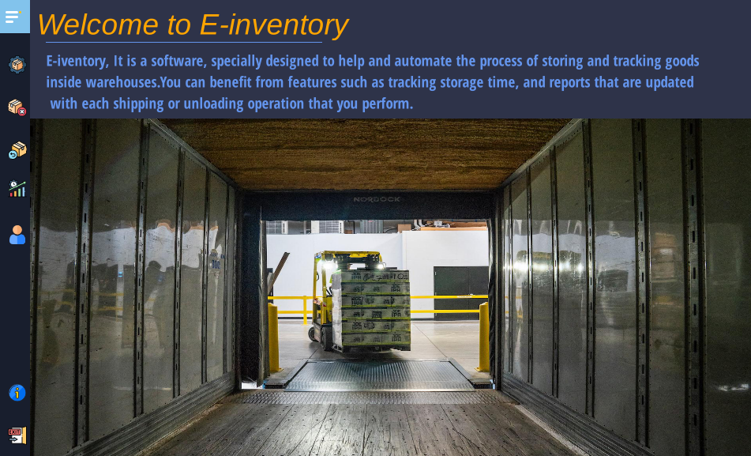
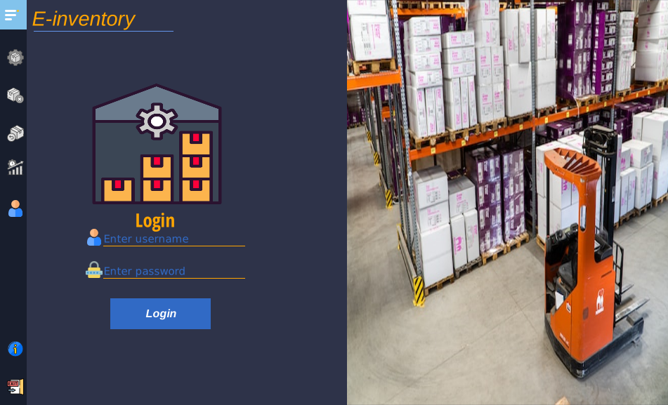
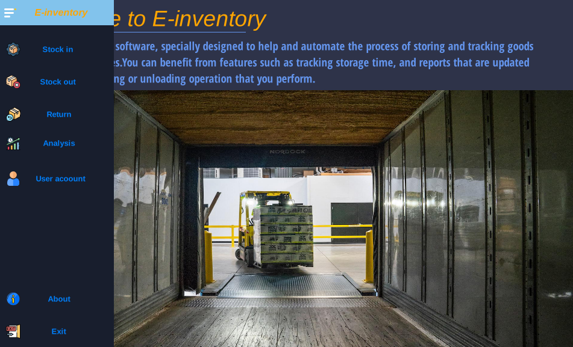
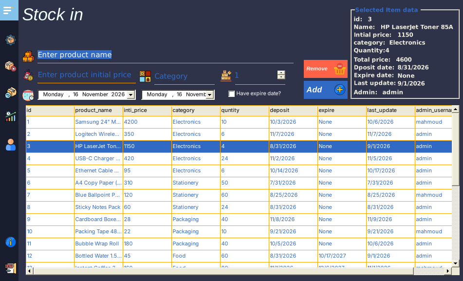
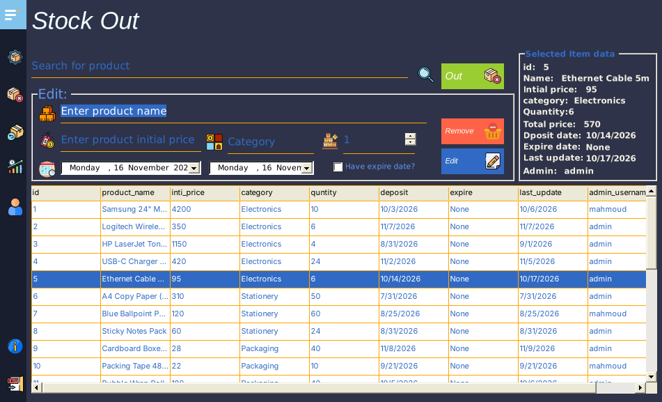
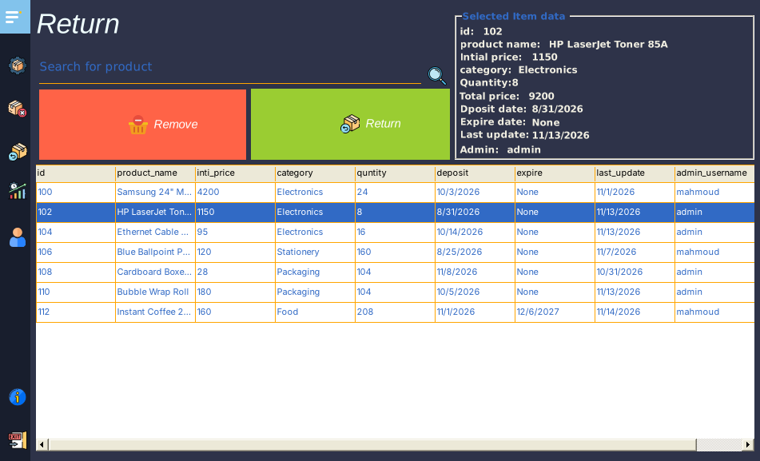
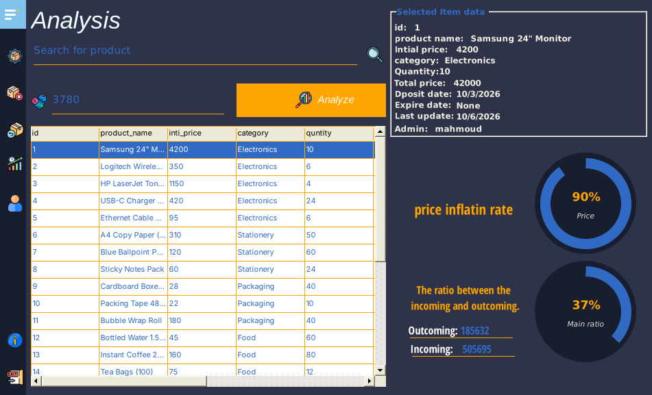
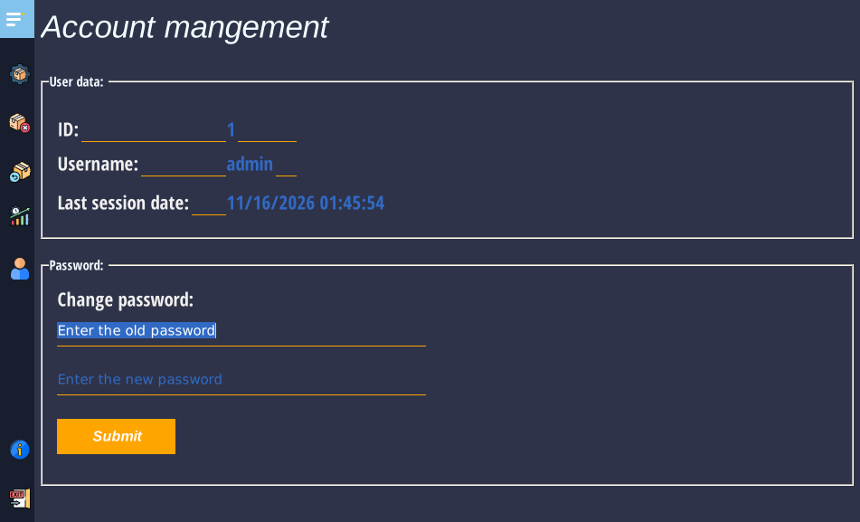
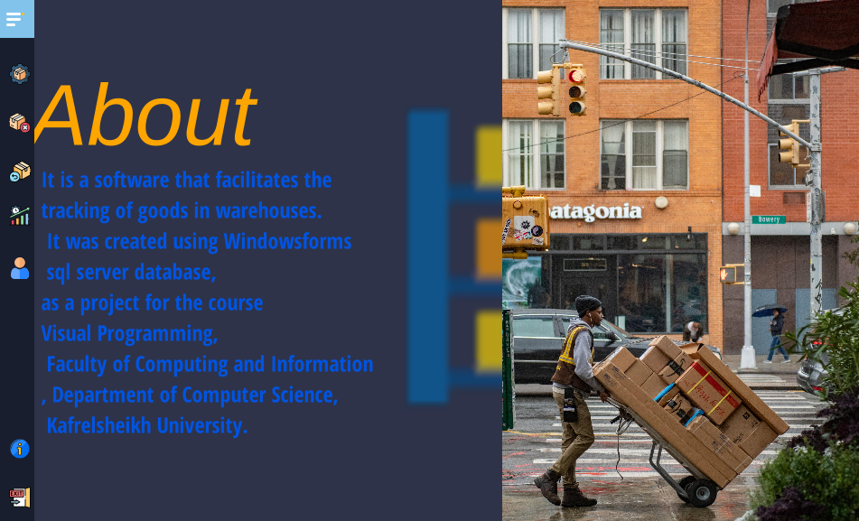

# E-inventory

A warehouse management app for Windows. It keeps track of what comes into the warehouse, what goes
out, what comes back, and how the value of the stock changes over time.

Built with C#, Windows Forms (.NET 6) and SQL Server.



> **About this project.** This was my second C# project, made in 2022 for the Visual Programming course
> (Faculty of Computing and Information, Kafrelsheikh University). The design held up well, the code
> less so: it is beginner code, with the database work written straight inside the screens. I keep it
> here as a record of where I started. See [What I would do differently today](#what-i-would-do-differently-today).

## Screenshots

| | |
|---|---|
| **Login**<br> | **Side menu**<br> |
| **Stock in**: add items, with an optional expiry date<br> | **Stock out**: send items out, edit or remove them<br> |
| **Return**: bring items that went out back into stock<br> | **Analysis**: price change and incoming vs outgoing value<br> |
| **Account**: user details and password change<br> | **About**<br> |

The screenshots use the sample data in [sample-data.sql](sample-data.sql).

## What it does

- **Log in** with a username and password. The menu stays locked until you log in.
- **Stock in**: add a product with its price, category, quantity, arrival date and an optional expiry
  date. Click a row to see all its details and its total value.
- **Stock out**: move an item out of the warehouse, edit it, remove it, or search by name.
- **Return**: move an item that went out back into stock.
- **Analysis**:
  - Pick an item and type its current price to see how much the price changed compared to when it came in.
  - See the total value that came in, the total value that went out, and the ratio between them.
- **Account**: see your user details and change your password.
- Every change records which admin made it and when.

## Run it

You need Windows, [Visual Studio 2022](https://visualstudio.microsoft.com/) with the ".NET desktop
development" workload, and [SQL Server Express](https://www.microsoft.com/sql-server/sql-server-downloads)
with SQL Server Management Studio.

1. **Create the database.** In SQL Server Management Studio, run `CREATE DATABASE Einventory;`
2. **Create the tables.** Open [Einventory.sql](Einventory.sql) and run it.
3. **Add a login and sample data.** Open [sample-data.sql](sample-data.sql) and run it. This adds the
   user `admin` with the password `admin123`, plus the items from the screenshots.
4. **Point the app to your SQL Server.** The connection string is written in six files: `main.cs`,
   `stockin_form.cs`, `stockout_form.cs`, `return_form.cs`, `analysis_form.cs` and `account_form.cs`.
   In each one, replace `MY13-LABTOP` with your server name, usually `.\SQLEXPRESS`:
   ```
   Data Source=.\SQLEXPRESS;Initial Catalog=Einventory;Integrated Security=True
   ```
5. Open `inventory.sln` in Visual Studio and press **F5**.

## Project layout

```
Einventory.sql        creates the tables (stockin, stockout, users)
sample-data.sql       sample items and the admin login
inventory/
  Program.cs          starts the app
  main.cs             main window: login, side menu, switching screens
  welcome_form.cs     welcome screen
  stockin_form.cs     stock in
  stockout_form.cs    stock out
  return_form.cs      returns
  analysis_form.cs    analysis and charts
  account_form.cs     account and password
  about_form.cs       about
  receipt.cs          a receipt screen (designed, not opened anywhere yet)
  images/             icons and photos
screenshots/          the pictures in this file
```

## What I would do differently today

This is a beginner project, and these are the things I would change now:

- **SQL built from typed text.** Queries are made by pasting what the user typed into the SQL text, so
  someone could type SQL into a box and run it (SQL injection). Today I would use parameters
  (`@name`) for every value.
- **A real bug in password change.** It runs `update users set password = ...` with no `WHERE`, so it
  changes the password of every user, not just the one logged in.
- **Plain text passwords.** Passwords are saved as they are typed. They should be stored as a hash.
- **The connection string is copied into six files.** It belongs in one settings file.
- **The database work lives inside the screens.** Each form opens the connection and writes its own SQL.
  A separate data layer would make the code shorter, testable and easier to change.
- **Dates are saved as text**, so sorting and date math don't work properly. They should be date columns.
- **Moving an item out takes the whole item.** There is no way to send out only part of the quantity.
- **Small things:** column names with typos (`quntity`, `inti_price`) and build folders (`bin`, `obj`,
  `.vs`) committed to the repo.

## Credits

Made by Mahmoud Yosri. Warehouse photos from [Unsplash](https://unsplash.com/). Uses the
[CircularProgressBar](https://github.com/falahati/CircularProgressBar) control for the charts.
